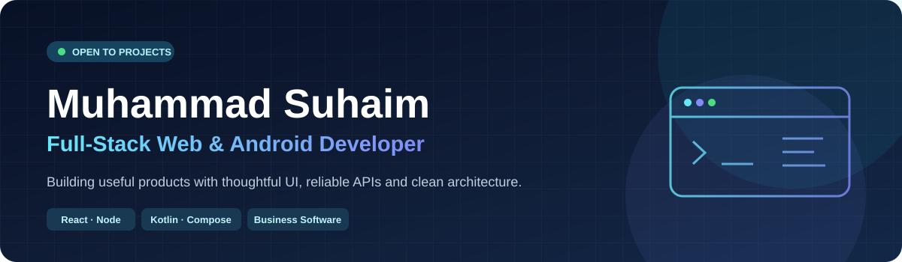

# Hi, I'm Muhammad Suhaim 👋

**Full-Stack Web & Native Android Developer** · Pakistan

I build practical digital products—from responsive storefronts and internal business tools to native Android applications. I focus on clear interfaces, maintainable code, and reliable data flows.

**[Explore my projects](#selected-work) · [Email me](mailto:muhammedsuhaim32@gmail.com)**

## What I can build

- **Web applications:** responsive interfaces, REST APIs, authentication, dashboards and business workflows
- **E-commerce & ordering:** product catalogs, carts, checkout flows and order management
- **Android applications:** Kotlin, Jetpack Compose, local persistence and API integrations
- **Business software:** inventory, invoicing, expense tracking and operational tools

## Selected work

| Project | What it demonstrates | Stack | Status |
|:--|:--|:--|:--|
| **[SNJ Gold Rates](https://play.google.com/store/apps/details?id=com.snj.goldrates)** | Gold/silver rates, historical prices and jewellery calculations | Kotlin · Jetpack Compose · Room · Retrofit · Firebase | Published Android app |
| **[StockDesk](https://github.com/msuhaim491/stockdesk)** | Inventory, customer management, sales and invoices | React · TypeScript · Node.js · SQLite | Personal demo |
| **[Dastarkhwan Ordering](https://github.com/msuhaim491/dastarkhwan-ordering)** | Restaurant menu, cart, checkout and order workflows | React · TypeScript · Cloudflare Workers · D1 | Personal demo |
| **[PocketLedger](https://github.com/msuhaim491/pocket-ledger)** | Offline expense tracking, insights and CSV export | Kotlin · Jetpack Compose · Room | Personal demo |
| **[FitForge](https://github.com/msuhaim491/fitforge-gym-landing)** | Responsive gym landing page | Web frontend | Personal demo |
| **[FOREVER E-commerce](https://github.com/msuhaim491/forever-mern-ecommerce)** | [Live storefront](https://forever-mern-suhaim491.netlify.app/), catalog, cart and admin dashboard | React · Express · MongoDB · Netlify Functions | Public demo · API verified by project owner · checkout testing pending |

## Technology

**Frontend:** React · TypeScript · JavaScript · HTML · CSS  
**Backend:** Node.js · REST APIs · Cloudflare Workers  
**Android:** Kotlin · Jetpack Compose · Material 3 · MVVM · Coroutines · StateFlow  
**Databases & services:** MongoDB · SQLite · Room · Cloudflare D1 · Firebase

## How I work

I care about user-friendly design, understandable project structure, input validation, and predictable backend behavior. My repositories include projects at different stages; I label personal demonstrations and published products clearly rather than presenting tutorial work as paid client engagements.

## Have a project in mind?

Need a website, internal tool, ordering platform, or Android application? Share your goals, key features, and timeline, and we can discuss a practical approach.

**📩 [Email: muhammedsuhaim32@gmail.com](mailto:muhammedsuhaim32@gmail.com)**  
**💻 [GitHub: @msuhaim491](https://github.com/msuhaim491)**

---

Building useful software, one thoughtful release at a time.

